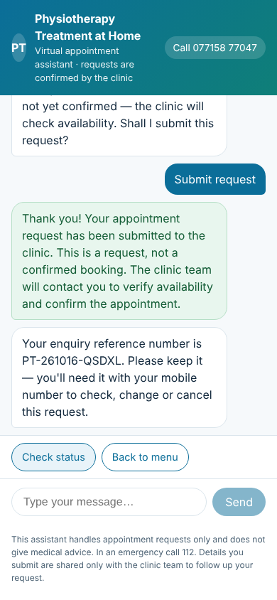
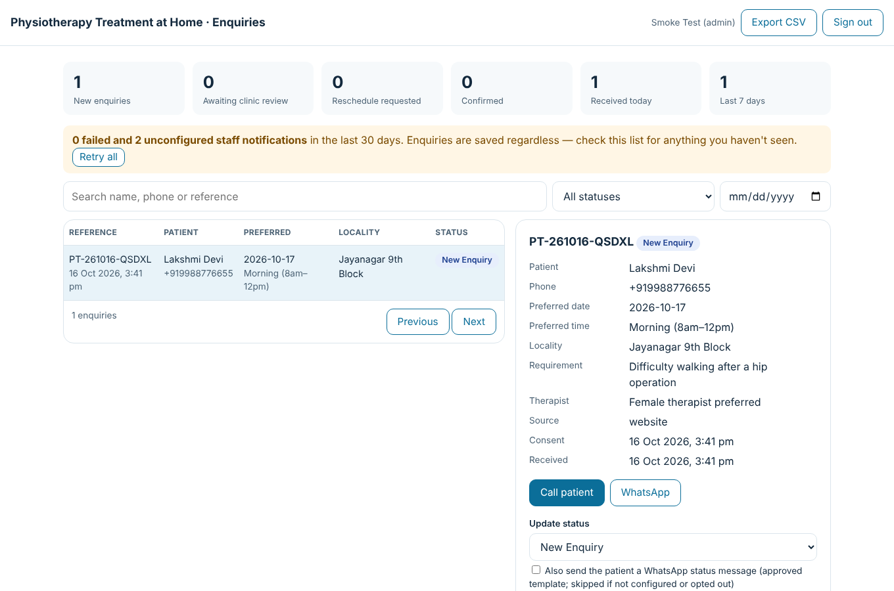

# physio- — Design / UI code

UI and design layer of the **Physiotherapy Treatment at Home** appointment-enquiry assistant. It is copied unchanged from the full application in [`physiotherapist-`](https://github.com/harshavardhangowda525-spec/physiotherapist-).

| Website chat (mobile) | Staff dashboard |
|---|---|
|  |  |

## What's here
| File | Purpose |
|---|---|
| `app/globals.css` | All styling and design tokens: calm blue/teal palette, rounded chat bubbles, quick-reply chips, progress bar, buttons, status badges, dashboard grid, responsive breakpoints, reduced-motion support |
| `components/ChatWindow.tsx` | Patient chat window: header with call button, step progress, message log, quick replies, composer, privacy note |
| `components/Dashboard.tsx` | Staff dashboard: metric tiles, notification alerts, search and filters, enquiry table, detail panel, notes, status history |
| `app/layout.tsx` | Root layout, metadata and a guard against browser-translation crashes |
| `app/page.tsx` | Landing page with embed instructions and a live widget preview |
| `app/chat/page.tsx` | Full-screen chat page (also the iframe target of the widget) |
| `app/staff/login/page.tsx` | Staff sign-in screen |
| `app/staff/page.tsx` | Dashboard page (server-side sign-in check) |
| `app/error.tsx`, `app/global-error.tsx` | Friendly error screens |
| `public/widget.js` | Embeddable floating "Book a home visit" button and chat panel for the clinic website |
| `lib/status.ts` | Status names, labels and patient-facing wording used by the dashboard |
| `docs/*.png` | Screenshots |

## Not standalone
These files are the front end only. To run, they need the backend from `physiotherapist-`:
- the chat engine and APIs (`/api/chat`, `/api/staff/*`)
- authentication (`lib/auth.ts`)
- the PostgreSQL database layer

`app/staff/page.tsx` imports `lib/auth` and `lib/db`, which are not included here. To run the full system, use `physiotherapist-`.
